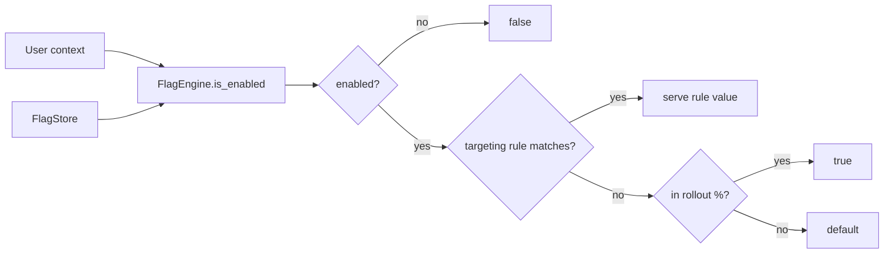

<p align="center">
  
</p>

<h1 align="center">Feature Flags</h1>

<p align="center">
  <strong>A tiny, deterministic feature flag engine — boolean flags, percentage rollouts, and targeting rules — in Python.</strong><br>
  Register a flag, evaluate it for a user, and ship features to exactly who you want — no service, no network.
</p>

<p align="center">
  <em>Built and maintained by <a href="https://viprasol.com">Viprasol Tech</a> — Fintech Experts. Full-Stack Builders.</em>
</p>

<p align="center">
  <a href="https://github.com/Viprasol-Tech/feature-flags/actions/workflows/ci.yml"></a>
  <a href="LICENSE"></a>
  
  <a href="https://t.me/viprasol_help"></a>
  <a href="https://github.com/Viprasol-Tech/feature-flags/stargazers"></a>
</p>

---

## ✨ Features

- 🎚️ **Boolean flags** — a master on/off switch; disabled flags are always off.
- 📈 **Percentage rollouts** — expose a feature to *p%* of users via a deterministic
  hash of `flag-key + user-id` (0–100). The same user always gets the same answer.
- 🎯 **Targeting rules** — force a flag on or off for users by attribute
  (`equals` / `in`), evaluated before the rollout.
- 🧮 **Reproducible bucketing** — SHA-256 based, stateless, and well-distributed,
  so a 30% rollout enables ≈30% of users — and the same set every run.
- 🗄️ **In-memory store** — `register` / `update` / `is_enabled` with validation.
- 🖥️ **CLI** — `feature-flags demo --rollout 40` evaluates a flag for several users.
- ⚙️ **Modern tooling** — ruff, mypy (strict), pytest, GitHub Actions CI.

## 🚀 Quickstart

```bash
git clone https://github.com/Viprasol-Tech/feature-flags.git
cd feature-flags
python -m pip install -e ".[dev]"

# Evaluate a flag with a 40% rollout for a set of demo users:
feature-flags demo --rollout 40
```

## 🧩 In-code usage

```python
from feature_flags import Comparator, Flag, FlagEngine, TargetingRule
from feature_flags.engine import UserContext

flag = Flag(
    key="new-checkout",
    enabled=True,
    rollout=25,  # 25% of users
    rules=[
        # ...but every enterprise customer always gets it:
        TargetingRule(attribute="plan", comparator=Comparator.EQUALS,
                      values=["enterprise"], serve=True),
    ],
    default=False,
)

engine = FlagEngine()
engine.is_enabled(flag, UserContext("carol", {"plan": "enterprise"}))  # True (rule)
engine.is_enabled(flag, UserContext("dave", {"plan": "free"}))         # rollout-dependent
```

## 🏗️ Architecture



## 🗺️ Roadmap

- [x] Boolean flags, percentage rollouts, and targeting rules
- [x] Deterministic SHA-256 bucketing + in-memory store
- [ ] Numeric/regex comparators and rule groups
- [ ] Multivariate flags (string/JSON variants, not just booleans)
- [ ] Pluggable persistent stores (file, Redis, SQL adapters)
- [ ] Evaluation event stream for analytics and A/B testing

## 🤝 Contributing

PRs welcome — see [CONTRIBUTING.md](CONTRIBUTING.md) and our [Code of Conduct](CODE_OF_CONDUCT.md).

## Contact — Viprasol Tech Private Limited

- Website: [viprasol.com](https://viprasol.com)
- Email: [support@viprasol.com](mailto:support@viprasol.com)
- Telegram: [t.me/viprasol_help](https://t.me/viprasol_help) | WhatsApp: +91 96336 52112
- GitHub: [@Viprasol-Tech](https://github.com/Viprasol-Tech) | [LinkedIn](https://www.linkedin.com/in/viprasol/) | X [@viprasol](https://twitter.com/viprasol)

## License

[MIT](LICENSE) (c) 2025 Viprasol Tech Private Limited
